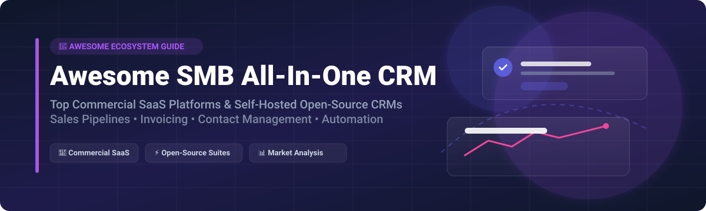

# 🚀 Awesome SMB All-In-One CRM Ecosystem 📊

  
  
  
  
  

## 📌 Overview

Welcome to the definitive **Awesome SMB All-in-One CRM** directory. This repository curates top-tier **commercial SaaS platforms** and powerful **self-hosted open-source GitHub projects**. Designed specifically for small and medium-sized businesses (SMBs), solopreneurs, and growing startups, these platforms integrate sales pipelines, lead tracking, customer support, contact management, invoicing, and marketing automation into a single cohesive platform.

---

## 📑 Table of Contents

- [📈 Market Size & Structure](#-market-size--structure)
- [💼 SaaS/Hosted Commercial Platforms](#-saashosted-commercial-platforms)
- [⚡ Open-Source GitHub Projects](#-open-source-github-projects)
  - [🏢 Full ERP/CRM Suites](#-full-erpcrm-suites)
  - [🎯 Dedicated & Modern CRM Platforms](#-dedicated--modern-crm-platforms)
- [🤝 How to Contribute](#-how-to-contribute)
- [💖 Support & Community](#-support--community)
- [⚖️ Disclaimer & Security Considerations](#%EF%B8%8F-disclaimer--security-considerations)
- [⭐ Star History](#-star-history)

---

## 📈 Market Size & Structure

The global Small and Medium Business (SMB) CRM market is estimated at **$22.5 Billion** and is projected to expand at a CAGR of **12.4%**. The SMB CRM market is **moderately fragmented**: category giants (Salesforce, HubSpot) dominate initial mindshare, yet dozens of specialized SaaS vendors and robust open-source alternatives (Dolibarr, EspoCRM, SuiteCRM, Twenty) capture substantial market share by catering to specific workflows, data sovereignty requirements, and cost-conscious business models.

---

## 💼 SaaS/Hosted Commercial Platforms

The table below lists top commercial SaaS CRM solutions, ranked by corporate scale (estimated market valuation / revenue, descending):

| 🏢 Platform | 💰 Starting Price | 🆓 Free Tier / Free Trial Limit | 📊 Corporate Scale (Valuation / Revenue) | 🎯 Key Focus & Best For |
| :--- | :--- | :--- | :--- | :--- |
| **[Salesforce Small Business Suite](https://www.salesforce.com/)** | $25 / user / month | 30-day free trial (Full features, no credit card required) | **~$280 Billion Market Cap** | Enterprise-grade engine simplified for SMB scaling |
| **[HubSpot CRM](https://www.hubspot.com/)** | $15 / seat / month (Starter) | **Free Forever** (Up to 5 users, 1,000,000 contacts, core CRM tools) | **~$30 Billion Market Cap** | Inbound marketing integration & generous free tier |
| **[Monday Sales CRM](https://monday.com/)** | $12 / seat / month | 14-day free trial (Pro features) & Free Forever plan (Up to 2 seats, 1,000 contacts) | **~$14 Billion Market Cap** | Workflow automation & visual board customization |
| **[Freshsales](https://www.freshworks.com/crm/sales/)** | $9 / user / month | 21-day free trial & Free plan (Up to 3 users, contact & deal management) | **~$5 Billion Market Cap** | AI-powered contact scoring (Freddy AI) & built-in phone/email |
| **[Zoho CRM](https://www.zoho.com/crm/)** | $14 / user / month | 15-day free trial & **Free Forever** (Up to 3 users, essentials only) | **~$5 Billion Valuation** (Private, $1B+ ARR) | Omnichannel sales automation & budget-friendly deep features |
| **[Pipedrive](https://www.pipedrive.com/)** | $14 / user / month | 14-day free trial (Full features, no credit card needed) | **~$1.5 Billion Valuation** (Vista Equity backed) | Pure visual sales pipeline management & deal velocity |
| **[Keap](https://keap.com/)** | $149 / month (includes 1500 contacts, 2 seats) | 14-day free trial (Full access) | **~$500 Million Valuation** | Service-business marketing automation & payment processing |
| **[HoneyBook](https://www.honeybook.com/)** | $16 / month | 7-day free trial (Full access) | **~$1+ Billion Valuation** (Unicorn status) | Freelancer & creative agency client management (proposals, contracts, billing) |
| **[Insightly](https://www.insightly.com/)** | $29 / user / month | 14-day free trial & Free plan (Up to 2 users, basic CRM features) | **~$100+ Million Valuation** | Integrated sales pipeline and post-sale project management |
| **[Copper](https://www.copper.com/)** | $12 / user / month | 14-day free trial (Full features) | **~$75+ Million Valuation** | Native Google Workspace (Gmail/Calendar/Drive) CRM integration |

---

## ⚡ Open-Source GitHub Projects

Open-source CRM platforms provide full data sovereignty, zero per-user seat fees, and complete UI/backend code extensibility. Below are top open-source projects sorted by GitHub star count (descending).

### 🏢 Full ERP/CRM Suites

| 📦 Repository | ⭐ Stars | 📜 License | 🛠️ Tech Stack | 💡 Core Strengths & Capabilities |
| :--- | :--- | :--- | :--- | :--- |
| **[Odoo](https://github.com/odoo/odoo)** |  | LGPL-3.0 | Python, JavaScript, PostgreSQL | Modular ERP & CRM suite with pipeline management, lead scoring, and automated marketing. |
| **[ERPNext](https://github.com/frappe/erpnext)** |  | GPL-3.0 | Python (Frappe), JS, MariaDB | 100% open-source ERP with built-in CRM, sales pipeline, inventory, and accounting. |
| **[Dolibarr](https://github.com/Dolibarr/dolibarr)** |  | GPL-3.0 | PHP, MySQL/MariaDB | Highly modular ERP/CRM, electronic billing (FacturX/Peppol), tax compliance, POS, and invoicing. |
| **[Vtiger CRM](https://github.com/vtiger-crm/vtigercrm)** |  | VPL (SugarCRM Public) | PHP, MySQL | Comprehensive sales, email marketing, help desk ticketing, inventory, and project tracking. |

### 🎯 Dedicated & Modern CRM Platforms

| 📦 Repository | ⭐ Stars | 📜 License | 🛠️ Tech Stack | 💡 Core Strengths & Capabilities |
| :--- | :--- | :--- | :--- | :--- |
| **[Twenty](https://github.com/twentyhq/twenty)** |  | AGPL-3.0 | React, TypeScript, NestJS, GraphQL | Modern Notion-style CRM with GraphQL APIs, custom fields, kanban boards, and auto-sync. |
| **[Monica](https://github.com/monicahq/monica)** |  | AGPL-3.0 | PHP (Laravel), Vue.js, MySQL | Personal relationship manager & contact network tracker for detailed client log history. |
| **[Krayin](https://github.com/krayin/laravel-crm)** |  | MIT | Laravel 11, Vue.js, Tailwind CSS | Lightweight, developer-friendly CRM for SMEs with omni-channel support and clean UI. |
| **[SuiteCRM](https://github.com/salesagility/SuiteCRM)** |  | AGPL-3.0 | PHP, GraphQL, MySQL | Enterprise-grade open-source Salesforce alternative; quotes, contracts, workflow automation, and reporting. |
| **[CiviCRM](https://github.com/civicrm/civicrm-core)** |  | AGPL-3.0 | PHP, MySQL | Purpose-built CRM for non-profits, associations, membership management, and fundraising. |
| **[EspoCRM](https://github.com/espocrm/espocrm)** |  | GPL-3.0 | PHP, Backbone.js, MySQL | Ultra-clean, fast web interface with robust entity manager, sales leads, and REST API. |
| **[YetiForce CRM](https://github.com/YetiForceCompany/YetiForceCRM)** |  | GPL-3.0 | PHP, JS, MySQL | Feature-rich Vtiger fork with modern UI, security compliance, processes, and calendar modules. |
| **[X2CRM](https://github.com/X2Engine/X2CRM)** |  | GPL-3.0 | PHP (Yii), MySQL | Sales force automation, marketing automation, process workflow engine, and lead scoring. |

---

## 🤝 How to Contribute

We welcome contributions from the SMB community, developers, and CRM enthusiasts!

1. 🍴 **Fork** this repository.
2. 📝 **Add or edit** entries in `README.md` keeping formatting consistent.
3. 📌 **Verify information**: Ensure links, license types, and feature summaries are accurate.
4. 🚀 **Submit a Pull Request (PR)** with a clear title and short summary of added/modified tools.

---

## 💖 Support & Community

Thank you for exploring and using this repository! If you find this resource valuable, please consider supporting the project:

- ⭐ **Star** this repository on GitHub to increase its visibility.
- 🍴 **Fork** and contribute additions or updates to help keep the resource comprehensive.
- 📢 **Share** it with fellow entrepreneurs, sales leaders, and open-source advocates.
- ☕ **Sponsor / Buy me a coffee**: Support ongoing maintenance via the [Sponsor Dashboard](https://github.com/sponsors/ishandutta2007).

---

## ⚖️ Disclaimer & Security Considerations

- **Community Curated**: This repository is an independent curation and is not officially affiliated with or endorsed by any vendor listed.
- **Data Sovereignty & Privacy**: CRMs handle sensitive customer PII. Self-hosted deployments require strict server security, firewall rules, backups, and adherence to regulations such as GDPR or CCPA.
- **Maintenance Overhead**: Open-source solutions eliminate licensing costs but transfer responsibility for maintenance, database backups, updates, and infrastructure security to your internal team.

---

## 📈 Star History

---

  <b>Built for SMB owners, sales leaders, and open-source advocates seeking CRM independence.</b> 
  ⭐️ Star this repository if you find it helpful!

